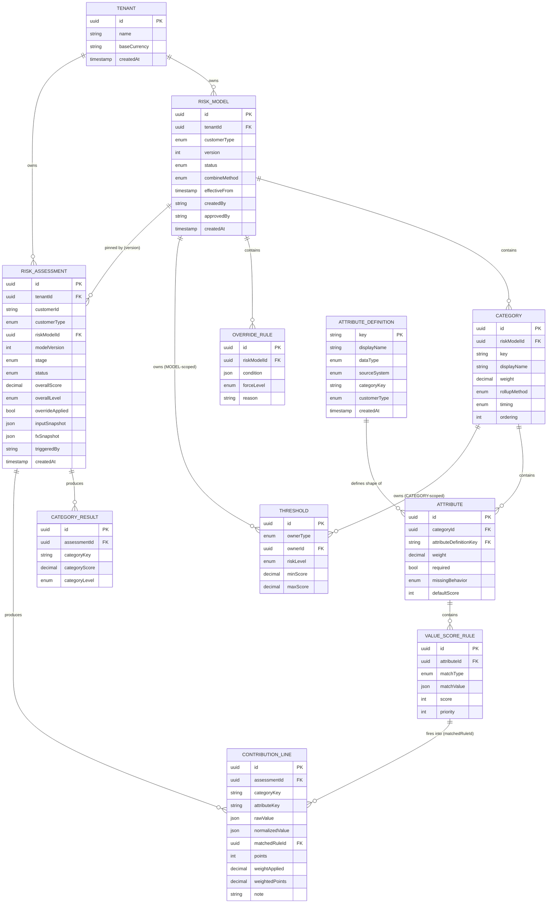

# CRA Engine — Data Model Reference

This is the full entity reference for the `risk` module (Phase 1 of
[`cra-engine-implementation-plan.md`](./cra-engine-implementation-plan.md)).
It mirrors §6 of the original design spec field-for-field — nothing summarised
away — so it can be read standalone when building the JPA entities and
migrations, plus one addition beyond the original spec: `AttributeDefinition`
(§2.1), the in-house catalog of which attributes can exist at all. This was
missing from the original spec and surfaced by comparing against a real
reference product's config UI (ComplyAdvantage) — see §2.1 for why it's
needed.

Generic types (`uuid`, `string`, `int`, `decimal`, `bool`, `timestamp`, `enum`,
`json`) map onto Postgres as: `uuid`, `text`/`varchar`, `integer`, `numeric`,
`boolean`, `timestamptz`, a Postgres `enum` or a checked `varchar`, and
`jsonb`, respectively.

---

## 1. Entity relationship diagram



**Three families of entity**, worth keeping distinct mentally:

- **Platform-owned catalog** — `AttributeDefinition`. Defined in-house
  (engineering/product), not by any tenant, and not scoped to a `Tenant` at
  all. Changes when we ship a new data integration, not on a tenant's
  schedule.
- **Model-authoring entities** — `Tenant`, `RiskModel`, `Category`,
  `Attribute`, `ValueScoreRule`, `Threshold`, `OverrideRule`. Tenant-authored
  configuration. `RiskModel` and everything under it is **immutable once
  `ACTIVE`** — editing always produces a new `DRAFT` version, never an
  in-place update.
- **Assessment/audit entities** — `RiskAssessment`, `CategoryResult`,
  `ContributionLine`. Produced by running the engine. **Append-only, always**
  — there is no update path for these, ever, at any status.

---

## 2. Platform-owned catalog

### 2.1 `AttributeDefinition`

The catalog of attributes that can ever exist on any tenant's model — `Age`,
`Salary amount`, `Country of residence`, `Sanction`, and so on. **This is
in-house defined**, not tenant-configurable: a tenant can't invent a new
attribute out of thin air, because every attribute needs a real data source
behind it (a form field, an ID-verification result, a registry lookup, a
screening hit). If nothing in the platform produces a value for it, it can't
be a `ValueScoreRule` target — so the set of what's *scorable* is bounded by
the set of what's *collectible*, and that set is ours to define, not a
tenant's.

There is deliberately no `POST` endpoint for tenants to create these. They're
seeded via migration (or an internal admin process) whenever engineering ships
a new data integration — e.g. adding a new registry lookup unlocks a new
`AttributeDefinition`, which then becomes available for every tenant to
optionally include in their own model.

| Field | Type | Notes |
|---|---|---|
| `key` | `string` | PK — natural, stable key, e.g. `age` |
| `displayName` | `string` | e.g. `"Age"` — what a tenant admin sees in the "Add" list |
| `dataType` | `enum` | `ENUM` \| `NUMBER` \| `BOOLEAN` \| `CURRENCY_AMOUNT` \| `DATE` \| `COUNTRY` |
| `sourceSystem` | `enum` | `MANUAL` \| `ID_VERIFICATION` \| `BIOMETRIC` \| `REGISTRY` \| `SCREENING` — which data pipeline actually supplies this value |
| `categoryKey` | `string` | Which category tab this belongs to, e.g. `basic_information`. Matched by convention against a tenant's `Category.key` (§2.4) when they add it — not a hard FK, since `Category` is tenant-scoped and this isn't |
| `customerType` | `enum` | `INDIVIDUAL` \| `BUSINESS` \| `BOTH` — which customer type(s) this definition is offered for. Most `country`/`product`/`channel`/`screening` attributes are `BOTH`; most `basic_information` attributes are type-specific (`age` vs. `age_of_business`), per §10.5 |
| `createdAt` | `timestamp` | |

**Invariant:** never deleted, only ever added to. Retiring a definition a
tenant has already included in an `ACTIVE` model would silently break that
model's reproducibility — if an attribute is no longer collectible, stop
offering it in the "Add" catalog for *new* models, but leave the definition
row (and any `Attribute` rows referencing it) intact.

---

## 3. Model-authoring entities

### 3.1 `Tenant`

The institution using the platform (a Kenyan fintech, microlender, remittance
firm, or VASP). Root of all per-institution configuration.

| Field | Type | Notes |
|---|---|---|
| `id` | `uuid` | PK |
| `name` | `string` | Institution name |
| `baseCurrency` | `string` | ISO 4217, e.g. `KES` — **Assumption A**: every tenant declares exactly one; all money attributes are normalised to it before scoring |
| `createdAt` | `timestamp` | |

---

### 3.2 `RiskModel` (versioned)

One tenant's scoring methodology for one customer type, at one version. This
is the unit of reproducibility — an assessment always pins to a specific
`RiskModel` row, never to "whatever the tenant's config currently is."

| Field | Type | Notes |
|---|---|---|
| `id` | `uuid` | PK |
| `tenantId` | `uuid` | FK → `Tenant` |
| `customerType` | `enum` | `INDIVIDUAL` \| `BUSINESS` — models are scoped per type |
| `version` | `int` | Monotonic per `(tenantId, customerType)` |
| `status` | `enum` | `DRAFT` \| `ACTIVE` \| `RETIRED` |
| `combineMethod` | `enum` | `WEIGHTED_SUM` \| `MAX` \| `HYBRID` — **recommend `HYBRID`** (§4.3) |
| `effectiveFrom` | `timestamp` | When this version went live |
| `createdBy` | `string` | For change governance (maker) |
| `approvedBy` | `string` | For change governance (checker) |
| `createdAt` | `timestamp` | |
~~~~

**Invariant:** immutable once `ACTIVE`. Editing an active model produces a new
`DRAFT` version; activating that draft retires the previously-active version
for the same `(tenantId, customerType)`. This is what makes old assessments
reproducible under the exact config that was live when they ran.

---

### 3.3 `Category`

A named group of attributes (Basic Information, Country, Product, Channel,
Screening). Lets a compliance officer reason at the right altitude and lets
whole domains of risk be weighted relative to each other.

| Field | Type | Notes |
|---|---|---|
| `id` | `uuid` | PK |
| `riskModelId` | `uuid` | FK → `RiskModel` |
| `key` | `string` | Stable machine key, e.g. `country` |
| `displayName` | `string` | e.g. `"Country"` |
| `weight` | `decimal` | Relative weight in the overall (cross-category) combination |
| `rollupMethod` | `enum` | `WEIGHTED_AVG` (default) \| `WEIGHTED_SUM` \| `AVERAGE` \| `MAX` — how attribute scores inside this category roll up |
| `timing` | `enum` | `ONBOARDING` \| `POST_ONBOARDING` — controls which assessment stages include this category (§5.2) |
| `ordering` | `int` | UI/audit display ordering |

---

### 3.4 `Attribute`

A tenant's **inclusion and scoring** of one catalog entry
(`AttributeDefinition`) inside one of their `Category`s. This is the
tenant-configurable half of "attribute" — the definition (§2.1) says *what it
is and where it comes from*; this says *whether this tenant uses it, and how
they score it*. `key`, `displayName`, `dataType`, and `sourceSystem` are no
longer declared here — they're inherited from `attributeDefinitionKey`.

| Field | Type | Notes |
|---|---|---|
| `id` | `uuid` | PK |
| `categoryId` | `uuid` | FK → `Category` |
| `attributeDefinitionKey` | `string` | FK → `AttributeDefinition.key` — a tenant can only pick from the in-house catalog, never declare a new one inline |
| `weight` | `decimal` | Weight within its category |
| `required` | `bool` | Drives missing-value behaviour |
| `missingBehavior` | `enum` | `DEFAULT_SCORE` \| `MAX_RISK` \| `INCOMPLETE` |
| `defaultScore` | `int?` | Used only when `missingBehavior = DEFAULT_SCORE` |

**Validation:** `attributeDefinitionKey` must resolve to an `AttributeDefinition`
whose `categoryKey` matches this `Attribute`'s `Category.key`, and whose
`customerType` is `BOTH` or matches the owning `RiskModel.customerType` — a
tenant can't add `Age` under their `country` category, or add an
`INDIVIDUAL`-only definition to a `BUSINESS` model.

**Invariant to enforce in validation, not just convention:** a `required`
attribute must **not** be configured with `missingBehavior = DEFAULT_SCORE` —
that lets a customer who withholds data score artificially low. Required +
missing must resolve to `INCOMPLETE` or `MAX_RISK` (§10.1).

---

### 3.5 `ValueScoreRule`

A mapping from a value (or range, set, or boolean) of an attribute to a
numeric score. This is where a tenant's risk appetite is actually expressed.

| Field | Type | Notes |
|---|---|---|
| `id` | `uuid` | PK |
| `attributeId` | `uuid` | FK → `Attribute` |
| `matchType` | `enum` | `EXACT` \| `RANGE` \| `SET` \| `BOOLEAN` \| `DEFAULT` |
| `matchValue` | `json` | Shape depends on `matchType` — e.g. `{"eq":"SO"}`, `{"min":18,"max":25}`, `{"in":["SO","IR","KP"]}`, `{"eq":true}` |
| `score` | `int` | `0`–`100`, normalised per §4.4 |
| `priority` | `int` | Lower = evaluated first; first match wins; `DEFAULT` is the fallback when nothing else matches |

---

### 3.6 `Threshold`

A band that maps a score to a risk level. Owned by either a `Category` (maps
that category's score to a category level) or the `RiskModel` itself (maps the
combined base score to the overall level) — kept **per-owner**, not global,
because a Country score of 60 and a Product score of 60 don't necessarily mean
the same thing to the institution.

| Field | Type | Notes |
|---|---|---|
| `id` | `uuid` | PK |
| `ownerType` | `enum` | `CATEGORY` \| `MODEL` |
| `ownerId` | `uuid` | FK → `Category` or `RiskModel`, per `ownerType` |
| `riskLevel` | `enum` | `LOW` \| `MEDIUM` \| `HIGH` |
| `minScore` | `decimal` | Inclusive |
| `maxScore` | `decimal` | Inclusive |

**Invariant to enforce in validation:** for a given owner, the set of bands
must be **contiguous, non-overlapping, and cover `[0, 100]`** completely — a
common and dangerous config error if unchecked.

---

### 3.7 `OverrideRule`

A hard rule that forces a minimum overall level when a dispositive condition
is met, independent of the arithmetic. This exists because arithmetic alone
dilutes dispositive signals (a confirmed sanctions match sitting in a
20%-weighted category can still average out to `MEDIUM` — not acceptable, see
§4.3). Override rules are what make the hybrid combine method safe.

| Field | Type | Notes |
|---|---|---|
| `id` | `uuid` | PK |
| `riskModelId` | `uuid` | FK → `RiskModel` |
| `condition` | `json` | e.g. `{"attribute":"sanctions","op":"eq","value":"CONFIRMED_MATCH"}` |
| `forceLevel` | `enum` | `MEDIUM` \| `HIGH` — **can only raise the overall level, never lower it** |
| `reason` | `string` | Human-readable justification, shown in the audit trail |

**Governance guardrail:** a model should not be `activate`-able without at
least one `OverrideRule` covering a confirmed sanctions match (§10.4) — a
tenant could otherwise ship an arithmetically toothless model.

#### `condition` grammar

`condition` is JSON, evaluated by `risk.engine.OverrideEvaluator` (Phase 3.4 of
the implementation plan) against the current assessment's attribute payload
**plus** the screening-gate result (Phase 6.1). Two node shapes, composable:

**Leaf condition** — tests one field:

```json
{"attribute": "<key>", "op": "<operator>", "value": <any>}
```

| `op` | Meaning |
|---|---|
| `eq` | equals |
| `ne` | not equals |
| `in` | value is one of a set |
| `not_in` | value is none of a set |
| `gt` / `gte` | greater than / or equal (numeric attributes) |
| `lt` / `lte` | less than / or equal (numeric attributes) |
| `exists` | attribute is present in the payload at all (ignores `value`) |

**Composite condition** — combines child conditions, nestable arbitrarily:

```json
{"all": [Condition, ...]}   // AND — every child must be true
{"any": [Condition, ...]}   // OR  — at least one child must be true
```

Example — the "biometric fail on a high-value product" override from §4.3,
which needs two attributes at once and can't be expressed as a single leaf:

```json
{
  "all": [
    {"attribute": "biometric_result", "op": "eq", "value": "FAIL"},
    {"attribute": "product_tier", "op": "eq", "value": "HIGH_VALUE"}
  ]
}
```

**The `attribute` key resolves against one of two namespaces:**

1. **Tenant-configured attribute keys** — must match an `Attribute.key` that
   exists in this `RiskModel`; evaluated against that attribute's raw (or
   normalised, for `CURRENCY_AMOUNT`) value from the assessment's payload.
2. **Reserved system keys**, not backed by any `Attribute` row. Currently just
   one: **`sanctions`**, which resolves to the sanctions blocking gate's
   result — `NO_HIT` \| `POTENTIAL_MATCH` \| `CONFIRMED_MATCH` — rather than
   anything in the tenant's own payload. `risk.config` validation must
   special-case this key (skip the "must reference a configured `Attribute`"
   check applied to every other key), and `AssessmentService` (not
   `OverrideEvaluator` itself) is responsible for injecting this value
   alongside the payload before evaluation, since it's the only caller that
   has already talked to `screening.service`.

> **Compliance flag.** The spec's own §7.2/§4.3 example condition —
> `{"attribute":"sanctions","op":"eq","value":"CONFIRMED_MATCH"}` — references
> `sanctions`, but no `Attribute` named `sanctions` is ever defined in either
> filled config example (§7.2's Screening category only defines `pep` and
> `adverse_media`). That's not an omission to fix by adding one: `sanctions`
> is deliberately **not** a scorable `Attribute` — it's the reserved key for
> the blocking gate outcome (§5.1a). Don't let a future implementer "complete"
> the config by adding a `sanctions` `Attribute` + `ValueScoreRule` under
> Screening — that would duplicate logic that already lives in the gate and
> risks the exact dilution problem override rules exist to prevent.

---

## 4. Assessment / audit entities

### 4.1 `RiskAssessment`

One execution of a specific `RiskModel` version against one customer's
attribute payload. **Never mutated after creation** — a re-assessment is
always a new row, never an update to an old one. The customer's "current risk
level" is simply the level of their latest `RiskAssessment`, derived by query,
not stored as separate mutable state.

| Field | Type | Notes |
|---|---|---|
| `id` | `uuid` | PK |
| `tenantId` | `uuid` | FK → `Tenant` |
| `customerId` | `string` | External customer reference |
| `customerType` | `enum` | `INDIVIDUAL` \| `BUSINESS` |
| `riskModelId` | `uuid` | FK → the **exact** `RiskModel` version used |
| `modelVersion` | `int` | Denormalised copy of `RiskModel.version`, for fast audit reads without a join |
| `stage` | `enum` | `ONBOARDING` \| `POST_ONBOARDING` — determines which categories were in scope (§5.2) |
| `status` | `enum` | `COMPLETE` \| `INCOMPLETE` |
| `overallScore` | `decimal` | Base score, **before** override |
| `overallLevel` | `enum` | Final level, **after** override |
| `overrideApplied` | `bool` | Whether any `OverrideRule` fired |
| `inputSnapshot` | `json` | The exact payload that was scored — reproducibility; nobody can argue later about what data was seen |
| `fxSnapshot` | `json` | FX rates used, with an as-of date (§10.2) — snapshotted, never re-looked-up on replay |
| `triggeredBy` | `string` | `ONBOARDING` \| `SCREENING_EVENT` \| `PERIODIC` \| `MANUAL` |
| `createdAt` | `timestamp` | |

---

### 4.2 `CategoryResult`

One row per category included in a given assessment — the subtotal layer of
the audit trail.

| Field | Type | Notes |
|---|---|---|
| `id` | `uuid` | PK |
| `assessmentId` | `uuid` | FK → `RiskAssessment` |
| `categoryKey` | `string` | |
| `categoryScore` | `decimal` | |
| `categoryLevel` | `enum` | `LOW` \| `MEDIUM` \| `HIGH` |

---

### 4.3 `ContributionLine`

One row per **scored attribute** per assessment — the finest-grained layer of
the audit trail, and the thing that actually answers "why did this attribute
score 90?" months later.

| Field | Type | Notes |
|---|---|---|
| `id` | `uuid` | PK |
| `assessmentId` | `uuid` | FK → `RiskAssessment` |
| `categoryKey` | `string` | |
| `attributeKey` | `string` | |
| `rawValue` | `json` | As received from the caller |
| `normalizedValue` | `json` | e.g. a currency amount converted to the tenant's base currency |
| `matchedRuleId` | `uuid?` | Which `ValueScoreRule` fired (nullable — e.g. when `missingBehavior` applied instead of a rule) |
| `points` | `int` | Score produced by that rule |
| `weightApplied` | `decimal` | The attribute weight used |
| `weightedPoints` | `decimal` | `points × weightApplied` |
| `note` | `string?` | e.g. `"value missing → DEFAULT_SCORE applied"` |

**Why both `rawValue` and `normalizedValue` are stored, and why
`matchedRuleId` is stored rather than just the resulting `points`:** this is
what lets a compliance officer reconstruct the full "why" — not just the
number — without needing the engineer or the current (possibly since-changed)
rule config.

---

## 5. Consolidated enum reference

| Enum | Values | Used on |
|---|---|---|
| `customerType` | `INDIVIDUAL`, `BUSINESS` (plus `BOTH` on `AttributeDefinition` only) | `RiskModel`, `RiskAssessment`, `AttributeDefinition` |
| `RiskModel.status` | `DRAFT`, `ACTIVE`, `RETIRED` | `RiskModel` |
| `combineMethod` | `WEIGHTED_SUM`, `MAX`, `HYBRID` | `RiskModel` |
| `rollupMethod` | `WEIGHTED_AVG`, `WEIGHTED_SUM`, `AVERAGE`, `MAX` | `Category` |
| `timing` | `ONBOARDING`, `POST_ONBOARDING` | `Category` |
| `dataType` | `ENUM`, `NUMBER`, `BOOLEAN`, `CURRENCY_AMOUNT`, `DATE`, `COUNTRY` | `AttributeDefinition` |
| `missingBehavior` | `DEFAULT_SCORE`, `MAX_RISK`, `INCOMPLETE` | `Attribute` |
| `sourceSystem` | `MANUAL`, `ID_VERIFICATION`, `BIOMETRIC`, `REGISTRY`, `SCREENING` | `AttributeDefinition` |
| `matchType` | `EXACT`, `RANGE`, `SET`, `BOOLEAN`, `DEFAULT` | `ValueScoreRule` |
| `ownerType` | `CATEGORY`, `MODEL` | `Threshold` |
| `riskLevel` | `LOW`, `MEDIUM`, `HIGH` | `Threshold`, `CategoryResult`, `RiskAssessment.overallLevel` |
| `forceLevel` | `MEDIUM`, `HIGH` | `OverrideRule` — note: no `LOW`, since an override can only raise |
| `stage` | `ONBOARDING`, `POST_ONBOARDING` | `RiskAssessment` |
| `RiskAssessment.status` | `COMPLETE`, `INCOMPLETE` | `RiskAssessment` |
| `triggeredBy` | `ONBOARDING`, `SCREENING_EVENT`, `PERIODIC`, `MANUAL` | `RiskAssessment` — modelled as `string` in the spec, but constrain it (Java enum or a DB check constraint) rather than a free-text field |

---

## 6. Cross-cutting invariants (repeated here on purpose — these are the ones that break audits if missed)

1. **`RiskModel` is immutable once `ACTIVE`.** No entity under it (`Category`,
   `Attribute`, `ValueScoreRule`, `Threshold`, `OverrideRule`) is ever updated
   after activation — a change means a new `DRAFT` version.
2. **`RiskAssessment`, `CategoryResult`, `ContributionLine` are append-only.**
   No update path exists for these at the repository layer, ever.
3. **`Threshold` bands are contiguous, non-overlapping, and cover `[0,100]`**
   for every distinct owner — validated before a model can move out of
   `DRAFT`.
4. **`OverrideRule.forceLevel` only ever raises the level.** Enforced both at
   config-validation time (reject an obviously-lowering rule) and at
   evaluation time (`max(baseLevel, all triggered forceLevels)`).
5. **A `required` `Attribute` never resolves a missing value to a silent low
   score.** `missingBehavior` must be `INCOMPLETE` or `MAX_RISK` when
   `required = true`.
6. **Every `Attribute`'s `ValueScoreRule.score` values live on the same
   `0`–`100` scale.** Required for weighted averages to mean anything; enforce
   in config validation (§4.4).
